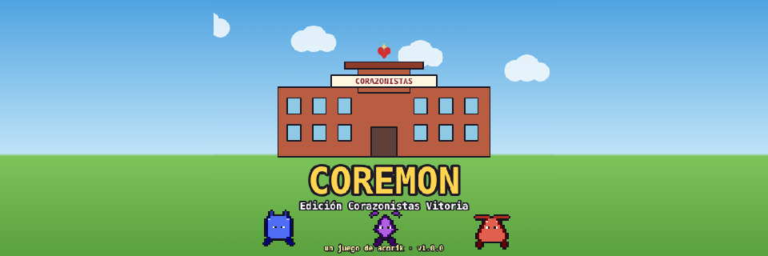
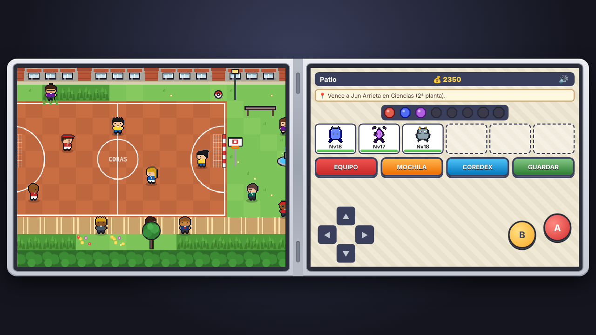
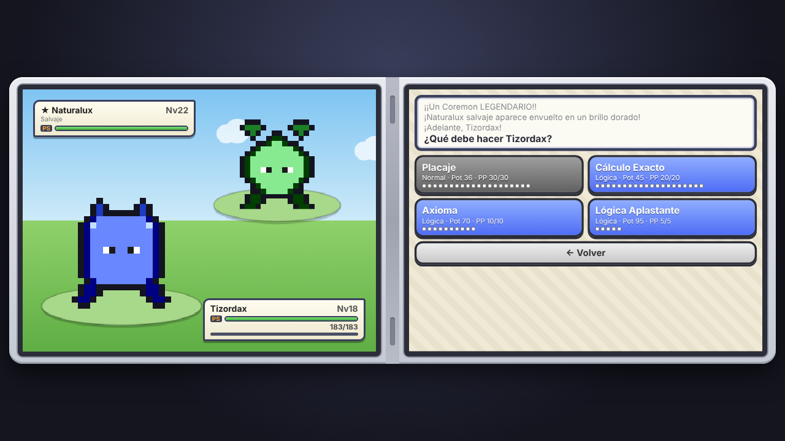
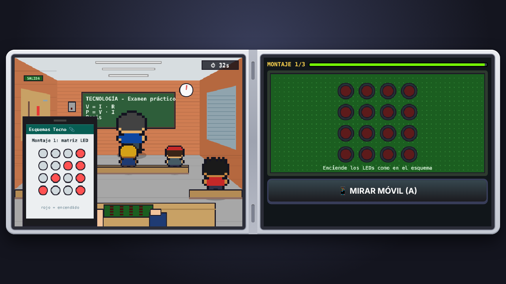
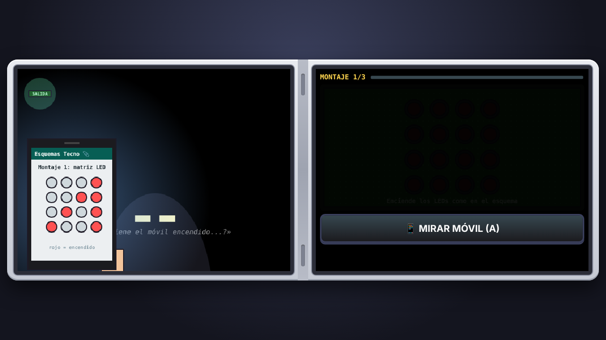

<h1 align="center">Coremon: Edición Corazonistas Vitoria</h1>

<b>Un juego de acorik</b> · versión 1.0.0

  <a href="https://acorik.itch.io/coremon"><b>🎮 Página oficial en itch.io: acorik.itch.io/coremon</b></a> 
  <a href="https://acorik.github.io/Coremon/">▶ Jugar en el navegador</a> ·
  <a href="https://github.com/acorik/Coremon/releases/latest">Todas las descargas</a>

## Descargar

| Plataforma | Descarga directa |
|---|---|
| 🤖 **Android** | [Coremon-1.0.0.apk](https://github.com/acorik/Coremon/releases/download/v1.0.0/Coremon-1.0.0.apk) |
| 🪟 **Windows** (instalador) | [Coremon-Setup-1.0.0.exe](https://github.com/acorik/Coremon/releases/download/v1.0.0/Coremon-Setup-1.0.0.exe) |
| 🪟 **Windows** (portable, sin instalar) | [Coremon-1.0.0-portable.exe](https://github.com/acorik/Coremon/releases/download/v1.0.0/Coremon-1.0.0-portable.exe) |
| 🐧 **Linux** | [Coremon-1.0.0.AppImage](https://github.com/acorik/Coremon/releases/download/v1.0.0/Coremon-1.0.0.AppImage) |
| 🍎 **macOS** (Apple Silicon M1/M2/M3…) | [Coremon-1.0.0-mac-arm64.dmg](https://github.com/acorik/Coremon/releases/download/v1.0.0/Coremon-1.0.0-mac-arm64.dmg) |
| 🍎 **macOS** (Intel) | [Coremon-1.0.0-mac-x64.dmg](https://github.com/acorik/Coremon/releases/download/v1.0.0/Coremon-1.0.0-mac-x64.dmg) |
| 🌐 **Web** (zip para jugar sin instalar o subir a itch.io) | [Coremon-1.0.0-web.zip](https://github.com/acorik/Coremon/releases/download/v1.0.0/Coremon-1.0.0-web.zip) |
| 🎮 **itch.io** | [acorik.itch.io/coremon](https://acorik.itch.io/coremon) |

Un RPG de captura de criaturas con aspecto de Nintendo DS (dos pantallas)
ambientado en un colegio de verdad: el Colegio Sagrado Corazón – Corazonistas
de Vitoria-Gasteiz. Cada asignatura es un gimnasio, cada profe un rival y el
jefe final lleva esperando desde 1821.

  
  
  
  

## Jugar

**En el navegador (PC o móvil):** en [acorik.itch.io/coremon](https://acorik.itch.io/coremon)
o en <https://acorik.github.io/Coremon/>. En el móvil, "Añadir a pantalla de inicio" lo instala como una app que
funciona sin conexión.

**Android:** descarga [Coremon-1.0.0.apk](https://github.com/acorik/Coremon/releases/download/v1.0.0/Coremon-1.0.0.apk) (o desde
[itch.io](https://acorik.itch.io/coremon)) y ábrelo (el móvil
pedirá permiso para "instalar apps de origen desconocido"). La app no pide
ningún permiso, no tiene anuncios y funciona sin internet. Se adapta al móvil en
vertical (consola a pantalla completa) y en horizontal (pantallas de lado), y el
botón "atrás" cierra menús (en el mapa, dos veces para salir).

**PC:**

| Sistema | Archivo | Notas |
|---|---|---|
| Windows | `Coremon-Setup-x.y.z.exe` o `Coremon-x.y.z-portable.exe` | El portable no necesita instalación |
| Linux | `Coremon-x.y.z.AppImage` | `chmod +x` y doble clic |
| macOS | `Coremon-x.y.z-mac-arm64.dmg` (Apple Silicon) o `-mac-x64.dmg` (Intel) | No está firmado: clic derecho → Abrir |

F11 activa la pantalla completa.

**Sin instalar nada:** descarga el repositorio (Code → Download ZIP),
descomprímelo y abre `index.html`. Hace falta la carpeta entera, no solo el HTML.

## Controles

| Acción | Teclado | Pantalla táctil |
|---|---|---|
| Moverse | Flechas / WASD | Cruceta |
| Correr | Mantener Shift | Mantener B |
| Hablar / usar (A) | Enter, Espacio o Z | Botón A |
| Atrás (B) | Esc, X o Retroceso | Botón B |

La pantalla de abajo tiene el equipo, la mochila, la Coredex, el guardado y
el **objetivo actual** (📍), para saber siempre adónde ir. La partida se guarda
sola al cambiar de sala. El botón 🔊 quita o pone el sonido (música y efectos
chiptune generados en el propio navegador, sin archivos de audio).

## Historia

En 1817, en Lyon, el joven sacerdote Andrés Coindre encontró a dos niñas
temblando de frío en el pórtico de Saint-Nizier, y en 1821 fundó los Hermanos
del Sagrado Corazón para educar a niños sin hogar. Doscientos años después,
empiezas tu primer día en el colegio de Vitoria, el centro corazonista con más
alumnos de España.

Cada asignatura es un gimnasio. Consigue las 6 insignias, supera la prueba del
Director y enfréntate al jefe final: el Padre Andrés Coindre, en la Sala del
Fundador. Al vencerle te avisa de que bajo el colegio duerme algo mucho más
grande... nos vemos en la Segunda Edición.

Por el colegio hay 8 páginas perdidas del **diario de Txema**, un alumno de
1971 que descubrió de dónde salen los Coremon. Se leen desde la mochila y, si
las juntas todas, hay premio.

**Después del final:** la hierba del patio y del jardín se revuelve (Coremon
de más nivel y muchos más legendarios, Corazonix incluido), aparece un alumno
misterioso muy fuerte en la zona salvaje y la trampilla del gimnasio...
respira.

## El colegio

Los espacios están recreados a partir de fotos reales del colegio.

- **Exterior:** fachada de pilastras de ladrillo rojo, piedra gris y
  ventanales blancos, entrada con arco y logo de Kristau Eskola.
- **Planta Baja:** vestíbulo de granito negro con pasillo central de granito
  beige, paredes de travertino y puertas de madera clara (secretaría,
  enfermería, máquinas expendedoras, taquillas, vitrina de trofeos). Puerta
  de cristal a la entrada principal y, al fondo del pasillo a la derecha, la
  escalera que sube al Patio. Pilares cuadrados de travertino con zócalo de
  granito. Gimnasio (suelo azul, rocódromo y colchonetas azules), Salón de
  Actos (butacas de madera con cojines de colores, escenario con cortinas
  rojas y pantalla), Capilla y Sala de Conferencias.
- **Patio:** se recorre hacia la derecha. Cancha de baloncesto y balonmano,
  fuente, bancos, profe de guardia, alumnos jugando (y el único futbolista,
  chutando contra la pared), la zona salvaje de hierba oscura y, al final del
  camino, el Jardín.
- **Pasillos de las plantas:** ladrillo naranja con mampara de cristal,
  terrazo azul-gris, murales y dibujos. Puertas con marco azul marino y ojo
  de buey: amarillas en 1ª y 3ª planta, azules en 2ª y 4ª.
- **1ª planta (Primaria):** Matemáticas y Lengua.
- **2ª planta (5º-6º):** Ciencias (laboratorio), Inglés, Sala de Apoyo
  (ordenadores, Coremon salvajes) y el **Taller de Tecnología**. Requiere 2
  insignias.
- **3ª planta (ESO):** Arte (caballetes) y Biblioteca. Requiere 4 insignias.
- **4ª planta (Bachillerato):** zona de entrenamiento con Coremon fuertes.
  Requiere 5 insignias.
- **5ª planta (Sala de Profesores):** despacho del Director, Sala de Castigo y
  Sala del Fundador (se abre al vencer al Director). Requiere 6 insignias.

Solo hay personal donde tiene sentido: cada profe en su aula, la enfermera, la
secretaria, la bibliotecaria, el conserje... Además hay alumnos paseando por
los pasillos y alumnos que te retan a combate.

## Misión del Taller: examen práctico

Un minijuego distinto, en primera persona. Tienes que hacer tres montajes
(matriz de LEDs, cableado y código) antes de que se acabe el tiempo. Los
esquemas solo los tienes en el móvil (A o el botón de abajo para mirarlo):

- Míralo solo cuando el profe esté de espaldas escribiendo en la pizarra. Si
  deja de escribir y carraspea (**¡EJEM!**), escóndelo: se va a dar la vuelta.
- Cuando se acaba el tiempo, salta el cuadro eléctrico y la clase se queda a
  oscuras unos segundos. A oscuras, la pantalla del móvil te delata: si lo
  enciendes, sus gafas brillan cada vez más cerca. Y si te vibra, siléncialo
  rápido.
- Si te pilla con el móvil, castigo en el quinto piso. Si apruebas: 1000
  monedas y un Coremon de nivel 18 que sale de tu placa.

## Combate

- **Luchar:** cada movimiento gasta PP. Los ataques de tu mismo tipo hacen un
  20% más, hay golpes críticos y bloqueos ocasionales.
- **Defender:** no atacas esa ronda, pero encajas muchísimo menos daño.
- **Mochila:** bocadillos y menús (curan), zumo (PP), tirita (reanima),
  caramelo raro (sube nivel), cromos y cromos dorados (capturar).
- **Equipo** y **Huir** (no se puede huir de un profesor).
- La experiencia se reparte: el que lucha recibe toda y el resto del equipo la
  mitad.
- El daño es constante: apenas varía entre un golpe y otro.
- Los Coremon salvajes suben de nivel a la vez que tu equipo. La **hierba
  oscura** (zona salvaje del patio y fondo del jardín) tiene Coremon de más
  nivel, ya evolucionados, y el doble de probabilidad de **legendarios** (★).
- Dicen que en la capilla el retrato del fundador esconde algo...

## Compilar

Todo el juego es HTML, CSS y JavaScript sin dependencias. Las versiones
instalables solo lo empaquetan:

| Versión | Cómo | Resultado |
|---|---|---|
| Web / itch.io | `tools/build-web.sh` | `dist/Coremon-x.y.z-web.zip` (sube este zip a itch.io como HTML) |
| Android | `cd android && ./gradlew assembleRelease` (necesita JDK 17+ y el SDK de Android) | `android/app/build/outputs/apk/release/app-release.apk` |
| PC | `cd desktop && npm install && npm run dist` | `desktop/release/` (instalador según tu sistema) |

**GitHub Actions** lo hace todo solo:

- `Builds` compila web, APK, Windows, Linux y macOS en cada cambio. Los
  archivos salen en la pestaña Actions → Artifacts. Para publicar una versión:
  Actions → Builds → Run workflow → escribe la etiqueta (p. ej. `v1.1.0`). Se
  crea la release con todos los archivos adjuntos.
- `GitHub Pages` publica la versión web. Para activarlo, ve a Settings → Pages
  → Source: **GitHub Actions**.
- Firma del APK: guarda la clave en los secretos del repositorio
  `COREMON_KEYSTORE_BASE64` (`base64 -w0 coremon-release.jks`) y
  `COREMON_KEYSTORE_PASSWORD`. Sin ellos, la release usa el APK oficial ya
  firmado que hay en `android/release/` para esa versión.

Para sacar una versión nueva, sube `GAME_VERSION` en `js/game.js`, `version`
en `desktop/package.json`, y `versionName` y `versionCode` en
`android/app/build.gradle.kts`.

Los textos, la portada y las capturas para itch.io están en
[`launch/`](launch/ITCHIO.md).

## Estructura

- `index.html`, `css/`, `js/`: el juego.
  - `js/data.js`: tipos, movimientos, especies, objetos, profesores, alumnos y
    el diario de 1971.
  - `js/sprites.js`: sprites pixel-art de Coremon (una silueta por línea
    evolutiva) y de personas (cada profe con su aspecto).
  - `js/scenery.js`: suelos, paredes, puertas y decoración (con animaciones).
  - `js/maps.js`: todas las salas del colegio.
  - `js/game.js`: mundo, movimiento, diálogos, cinemáticas y final.
  - `js/ui.js`: pantalla inferior (menús, mochila, tienda, taquillas, Coredex).
  - `js/battle.js`: combate.
  - `js/taller.js`: minijuego del Taller de Tecnología.
  - `js/audio.js`: música y efectos de sonido (WebAudio).
- `icons/`, `manifest.webmanifest`, `sw.js`: iconos y versión instalable (PWA).
- `android/`: app de Android (WebView a pantalla completa, sin permisos).
- `desktop/`: app de PC (Electron).
- `launch/`: portada, banner, capturas y textos para itch.io.
- `tools/`: scripts de compilación.

Para cambiar el aspecto de un profesor, edita su `look` en `TRAINERS`
(`js/data.js`): peinado (`short`, `long`, `bald`, `spiky`, `curly`, `crest`,
`bun`, `cap`), colores de pelo, piel, camisa y pantalón, gafas, barba, bata,
sudadera, falda o sotana.

## Créditos

**Idea, diseño y desarrollo: acorik.**

Proyecto de fans, hecho por y para la comunidad del Colegio Sagrado Corazón –
Corazonistas de Vitoria-Gasteiz. La historia del Padre Andrés Coindre
(1787-1826) y de los Hermanos del Sagrado Corazón está basada en hechos reales.
Lo de los Coremon, no (o eso dicen).

© acorik. Todos los derechos reservados.
